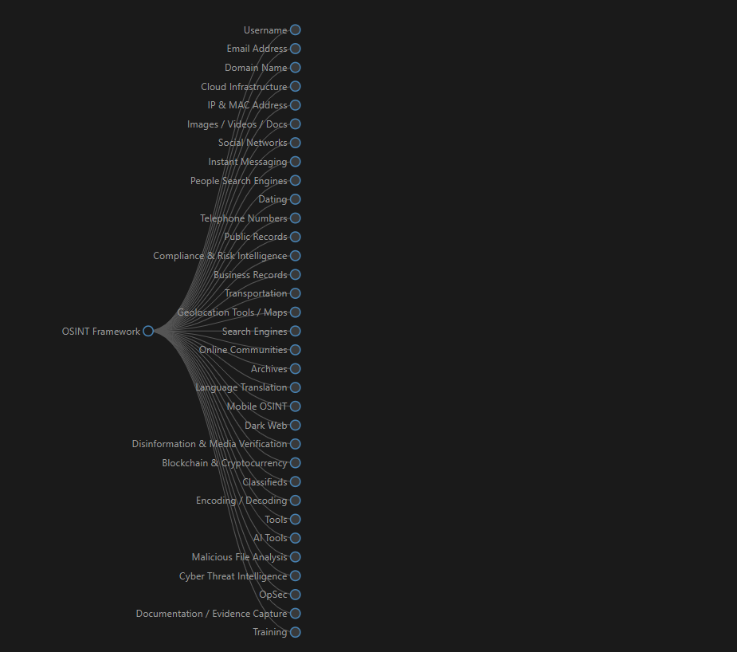
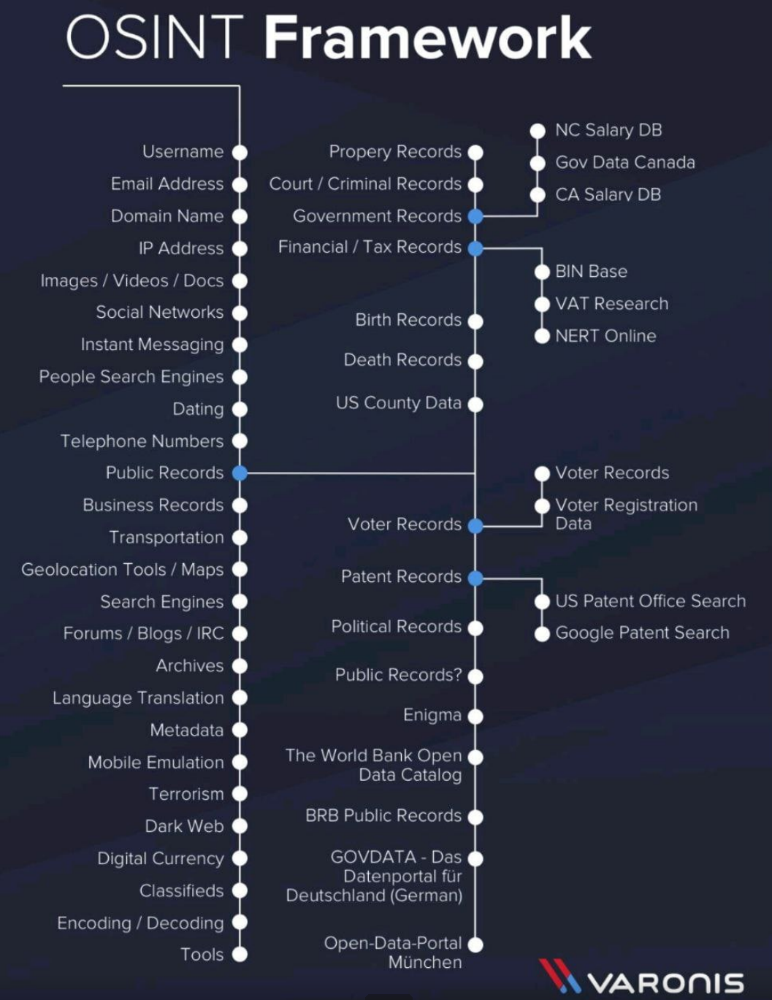
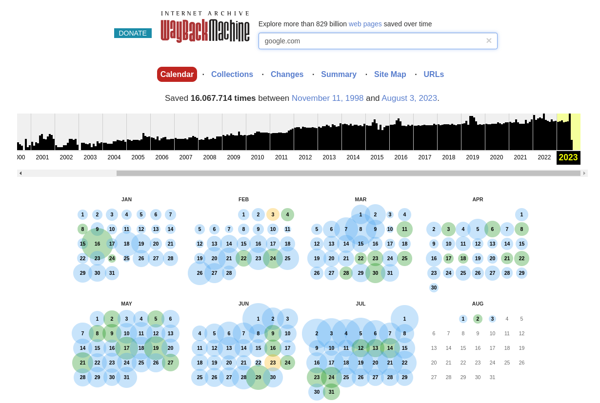
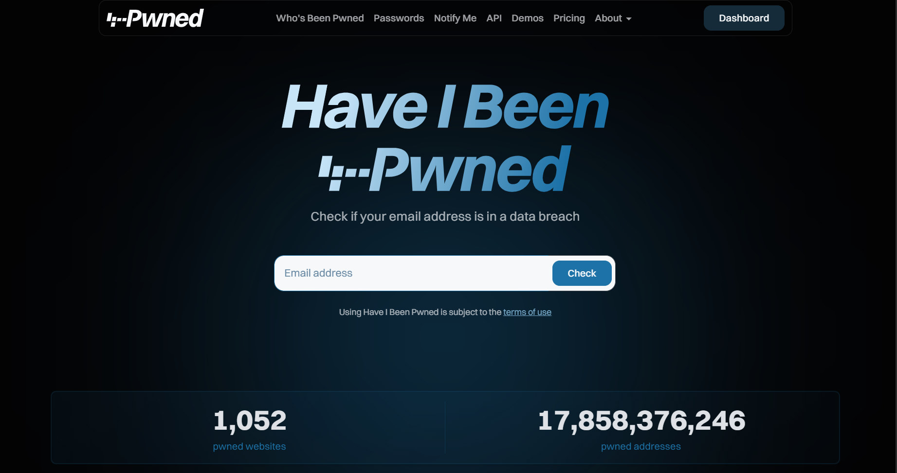
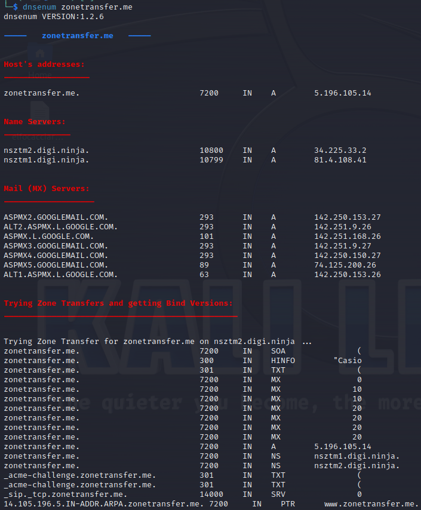
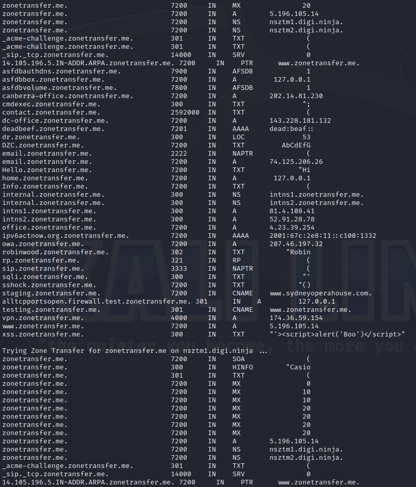
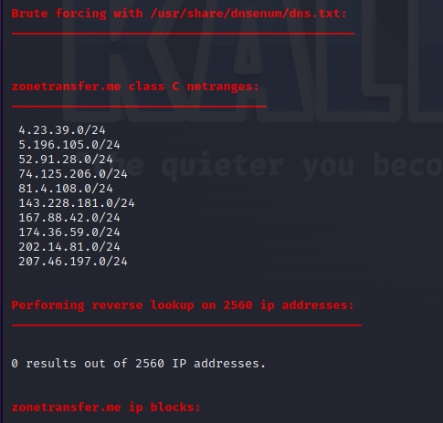
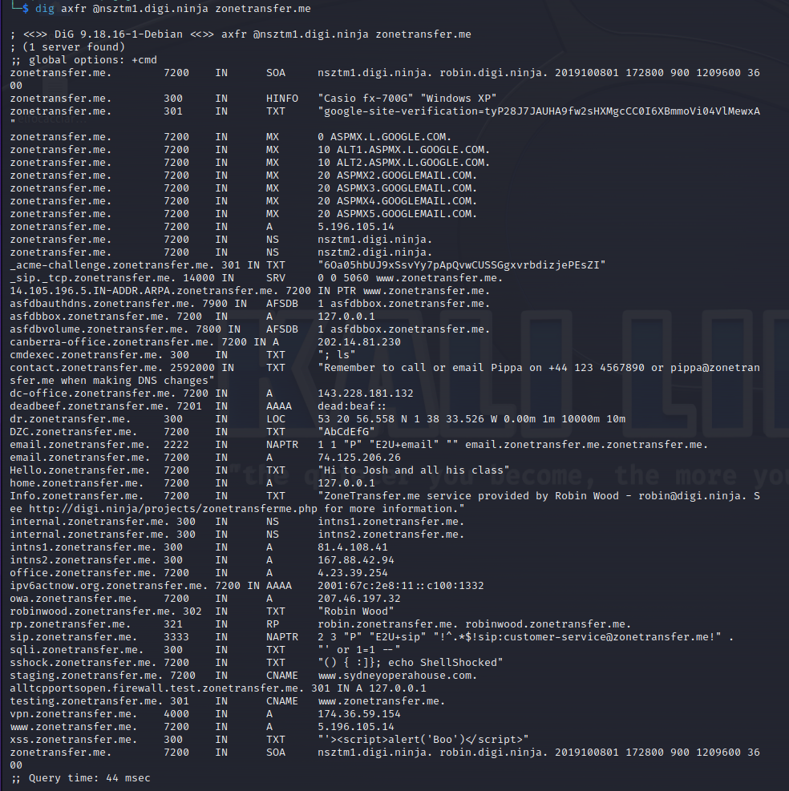

# 1.1 Information Gathering

**Domain:** Assessment methodologies | **Status:** draft | **Authorized targets only**

---

## 1. How it works (from zero)

Information gathering is the first phase of a pentest. Everything that comes later — scanning, enumeration, exploitation — is only as good as the data collected here. The more comprehensive the data, the higher the chance of a successful engagement later.

Information gathering splits into two categories:

**Passive information gathering** — collecting data without directly interacting with the target. This includes:
- Identifying IP addresses and DNS information
- Identifying domain names and domain ownership information
- Identifying email addresses and social media profiles
- Identifying web technologies in use on target sites
- Identifying subdomains

**Active information gathering** — actively interacting with the target system. This requires proper authorization. It includes:
- Discovering open ports on target systems
- Learning about the internal infrastructure of a target network/organization
- Enumerating information directly from target systems

### Reconnaissance and footprinting
**Reconnaissance ("recon")** is usually associated with the passive side of information gathering: collecting data about a target without directly touching its systems.

**Footprinting** is a specific phase of recon focused on building a detailed picture — a "footprint" — of a target's digital presence. It combines both passive and active methods to map IP addresses, domain names, network infrastructure, organizational structure, technical contacts, and more.

On a website specifically, footprinting tries to find:
- IP address
- Directories hidden from search engines
- Names, email addresses, phone numbers, physical addresses
- Web technologies in use

### The OSINT Framework
The **OSINT Framework** (osintframework.com) is a map of free OSINT tools and sources, organized as a tree from a root node out to dozens of categories: usernames, email addresses, domains, IP/MAC addresses, social networks, people-search engines, public/business/government records, geolocation, the dark web, and more. It's less a tool itself and more a directory — useful as a checklist so you don't forget a category of source when working a target.




### robots.txt
The `robots.txt` file tells web crawlers which parts of a site not to crawl/index. It's a convention, **not an access control** — anyone can request it directly.

```
User-agent: *
Disallow: /private/
Disallow: /temp/
Allow: /public/
Sitemap: https://www.example.com/sitemap.xml
```
`*` applies the rule to all crawlers. This example disallows `/private/` and `/temp/`, allows `/public/`, and points to the sitemap.

### Sitemaps
A **sitemap** (often at `/sitemap_index.xml` or `/sitemap.xml`) is the site owner's own organized index of their pages — the opposite intent of robots.txt, but just as useful for mapping what exists.

### Identifying web technologies
To fingerprint the CMS/framework/stack behind a site:
- Browser add-ons: **BuiltWith**, **Wappalyzer**
- CLI: **WhatWeb**
- Full offline mirror + analysis: **HTTrack Website Copier**

### WHOIS
**WHOIS** is a protocol/command for looking up registration details of a domain or IP — "who is [the owner]?" Running `whois example.com` typically returns the registrar, registration/expiration dates, and technical/administrative contacts (often redacted by privacy services today).

### Netcraft
**Netcraft** is a web-based recon tool that reports on a site's hosting provider, domain history, and technology stack, and separately tracks phishing/malware activity across the internet. Useful both for recon on a target and for understanding what's publicly knowable about an organization's infrastructure without touching it directly.

### DNS reconnaissance
DNS (Domain Name System) translates domain names into IP addresses. **DNS recon** means querying DNS servers to learn about a target's infrastructure through its DNS records.

Record types worth knowing:
| Record | Holds |
|---|---|
| A | domain → IPv4 address |
| AAAA | domain → IPv6 address |
| CNAME | alias → another domain name |
| MX | mail servers for the domain |
| TXT | free text (SPF, verification strings) |
| SRV | location of a specific service |
| PTR | IP → domain (reverse lookup) |
| NS | authoritative name servers for the domain |
| SOA | admin contact, serial number, refresh/retry timers |

Aspects of DNS recon:
- **Subdomain enumeration** — finding subdomains tied to a target domain; a common way in, since dev/staging/admin subdomains are often less hardened than the main site.
- **Reverse DNS lookup** — IP → domain name, useful for identifying what else is hosted on a given IP.
- **Zone transfers** — see below; the biggest find if misconfigured.
- **Cache snooping** — querying a DNS cache for recently resolved records, which can reveal internal network structure or browsing history.

### Local DNS with /etc/hosts
`/etc/hosts` (Unix-like systems) maps hostnames to IPs **locally**, checked *before* any DNS query is made. Format: `<IP> <hostname>`.
```
127.0.0.1   localhost
192.168.1.1 example.com
```
Useful in labs to point a hostname at a target IP when there's no real DNS server involved, and (outside pentesting) for ad-blocking or local dev overrides.

### DNSRecon and DNSenum
**DNSRecon** and **DNSenum** are Python-based DNS enumeration tools. Between them they cover: checking NS records for zone transfer vulnerability, pulling general DNS records (MX/SOA/NS/A/AAAA/SPF/TXT), SRV enumeration, TLD expansion, wildcard detection, subdomain brute-forcing, reverse PTR lookups on an IP range, DNS cache snooping, and Google-based subdomain discovery.

### DNSdumpster
**DNSdumpster** is a domain research tool that finds hosts related to a domain **without brute-forcing subdomains** — instead it pulls from existing open-source datasets (crawl data, search engines, Certificate Transparency logs, Shodan, and more) to surface subdomains and hosts that might otherwise be hard to find.

### Zone transfers, in depth
A **DNS zone transfer** replicates zone data from a primary (master) DNS server to secondary (slave) servers, so all authoritative servers for a domain stay in sync. There are two transfer types:
- **AXFR (full zone transfer)** — the secondary requests the *entire* zone.
- **IXFR (incremental zone transfer)** — only the changes since the last sync.

If a DNS server is misconfigured to answer AXFR requests from **anyone**, not just authorized secondaries, it hands over the entire internal DNS map to an attacker.

### Web Application Firewalls (WAF)
A **WAF** sits in front of a web app and inspects HTTP/HTTPS traffic, aiming to block attacks like SQL injection, XSS, CSRF, LFI/RFI, and brute-force attempts, and to catch OWASP Top Ten classes of vulnerability generally. Knowing a WAF is present changes how noisy/careful later testing needs to be.

**WAFW00F** is the standard CLI tool for WAF fingerprinting: it sends crafted HTTP requests and analyzes the responses (headers, behavior, error pages) to determine whether a WAF is present and, often, which vendor/product it is.

### Subdomains and subdomain enumeration
A subdomain is a prefix on a domain (`sub.example.com`), used to organize content, separate departments, host APIs, serve mobile versions, run dev/test environments, and more. For an attacker, subdomains matter because:
- The main domain is usually the most hardened asset; `dev.`, `staging.`, `old.` subdomains often aren't.
- Forgotten or unmonitored subdomains widen the attack surface.
- A subdomain pointing (via CNAME) to a deprovisioned third-party service can be hijacked — a **subdomain takeover**.

**Sublist3r** is an open-source subdomain enumeration tool that queries search engines, DNS records, and public data sources to find subdomains tied to a domain — useful for recon, red team scoping, and asset discovery.

### Google Dorks
**Google Dorks** (Google Hacking) use Google's advanced search operators to surface information that isn't meant to be easily found: exposed files, misconfigured servers, login pages, leaked credentials, and more.

Examples:
```
intitle:"index of" "parent directory"        # open directory listings
filetype:pdf site:example.com                 # PDFs on a specific domain
intitle:"Apache HTTP Server Test Page" intext:"It works!"   # default/unconfigured servers
inurl:login site:example.com                  # login pages
site:example.com ext:sql                      # exposed SQL files
```
**Always scope dorks with `site:` to the authorized target.** A large collection of categorized dorks lives at the **Exploit-DB Google Hacking Database**.

### Wayback Machine
The **Wayback Machine** (Internet Archive) stores historical snapshots of web pages over time. For recon, this means you can see **removed content, old endpoints, and earlier versions of a site** that may no longer be linked anywhere live.



### Email harvesting
**Email harvesting** is collecting email addresses tied to a target, via web scraping, search-engine dorking, online directories, or (illegitimately) data breaches. For a pentester, the legitimate use is understanding an organization's email naming convention and potential phishing/social-engineering surface (only within agreed scope).

**theHarvester** is the standard tool for this: it pulls email addresses, subdomains, hosts, and employee names from public sources (search engines, Certificate Transparency logs, LinkedIn, etc.) during the reconnaissance phase. Its scope also covers subdomain enumeration, host discovery, and metadata extraction from documents linked to the domain.

### Leaked password databases & Have I Been Pwned
A **leaked password database** is a compiled set of credentials (username/email + password or hash) exposed through past breaches. These circulate among attackers and get used for credential stuffing against other services.

**Have I Been Pwned (HIBP)**, built by Troy Hunt, lets you check whether an email or username appears in a known breach, and separately whether a specific password has appeared in a breach — without ever sending the actual password to the service (it uses k-anonymity: only the first 5 characters of the password's SHA-1 hash are sent).



---

## 2. The attacker's view

| What | Tools / sources | Passive / active | What you get |
|---|---|---|---|
| Domain ownership | `whois` | passive | registrar, dates, contacts |
| Technologies | BuiltWith, Netcraft / WhatWeb, Wappalyzer | passive / active | CMS, server, framework, versions |
| Subdomains | Sublist3r, theHarvester, DNSdumpster | passive | dev/admin hosts the main site doesn't advertise |
| DNS records & zone transfers | DNSRecon, DNSenum, `dig`, `host` | active* | full record set, and potentially the entire zone |
| Emails & people | theHarvester | passive | phishing/social-engineering surface, naming convention |
| Exposed files | Google dorks | passive | documents, admin pages, configs |
| Historical content | Wayback Machine | passive | removed pages, old endpoints |
| Leaked credentials | Have I Been Pwned | passive | which breaches include the org's emails |
| WAF presence | WAFW00F | active | whether/which WAF is in front of the app |

*Fetching the target's own `robots.txt` or running a banner-grab is a real request to the target — strictly active, just quiet.

**Why a successful zone transfer matters so much:** it hands over every hostname in the zone at once — internal subdomains, mail/VPN/admin hosts, sometimes internal IP ranges — turning weeks of subdomain brute-forcing into one request.

---

## 3. Methodology

```bash
# --- Passive ---
whois example.com
host example.com
dig example.com MX
dig example.com NS
dig example.com TXT

sublist3r -d example.com
theHarvester -d example.com -b crtsh,duckduckgo -l 200

# Google dorks — always scope with site:
#   site:example.com filetype:pdf
#   site:example.com inurl:login
#   site:example.com ext:sql

# --- Active (authorized targets only) ---
curl -s https://example.com/robots.txt
curl -s https://example.com/sitemap.xml
whatweb https://example.com
wafw00f https://example.com

# DNS enumeration and zone transfer attempts
dnsrecon -d example.com
dnsrecon -d example.com -t axfr
dnsenum example.com
dig axfr @ns1.example.com example.com
```

### 📸 Screenshots / proof of work

**DNS zone transfer against `zonetransfer.me`** (a legal, intentionally-misconfigured public practice domain built for exactly this kind of test):

```
dnsenum zonetransfer.me
```



_What this shows: the zone transfer succeeded and dumped every record in the zone — subdomains (`staging`, `internal`, `vpn`, `office`), an exposed TXT record with a phone number and name, a CNAME pointing at an unrelated domain, and even records containing deliberate XSS/SQLi test strings. This is the real-world version of "why zone transfer misconfiguration matters" from section 2 above._

`dnsenum`'s brute-force module additionally derived the domain's class-C netranges from the recovered records:


Confirming the same finding directly with `dig` (no brute-forcing, just a clean AXFR request):
```
dig axfr @nsztm1.digi.ninja zonetransfer.me
```


_Note: these two tools (`dnsenum`, `dig axfr`) against the same misconfigured zone return the same data in different formats — good to know both, since some environments block one tool's traffic pattern but not the other's._

---

## 4. Real-world relevance & further reading

- **Zone transfer misconfiguration** (as demonstrated above) is a classic, still-common finding in real engagements and CTFs — `zonetransfer.me` exists specifically to let people practice it safely and legally.
- **Subdomain takeover** via dangling CNAME records is a frequent bug-bounty finding.
- **Credential stuffing** using emails pulled from breach data (HIBP) against other services.
- **Exposed files via Google dorks** — see the Exploit-DB Google Hacking Database for curated dork collections.

Further reading: OWASP Web Security Testing Guide ("Information Gathering" chapter), digi.ninja/projects/zonetransferme.php (background on the practice domain itself).

---

## 5. Self-test

1. Why is fetching a target's own `robots.txt` technically active, not passive?
2. What exactly does a successful AXFR give an attacker, beyond "a list of subdomains"?
3. Why is `zonetransfer.me` a safe, legal target to practice zone transfers against?
4. What's the difference in approach between DNSdumpster and Sublist3r/theHarvester for finding subdomains?
5. Why does HIBP's password-check feature not need your actual password?

---

## 6. Quick recap

- Passive = third-party data only; active = real traffic to the target, needs authorization.
- The OSINT Framework is a map of sources, not a tool — use it to avoid missing a category.
- DNS records, subdomains, and historical content map the attack surface before any scan.
- A misconfigured zone transfer is one of the highest-value single findings in information gathering — confirmed hands-on above against `zonetransfer.me`.
