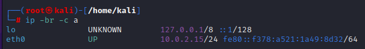
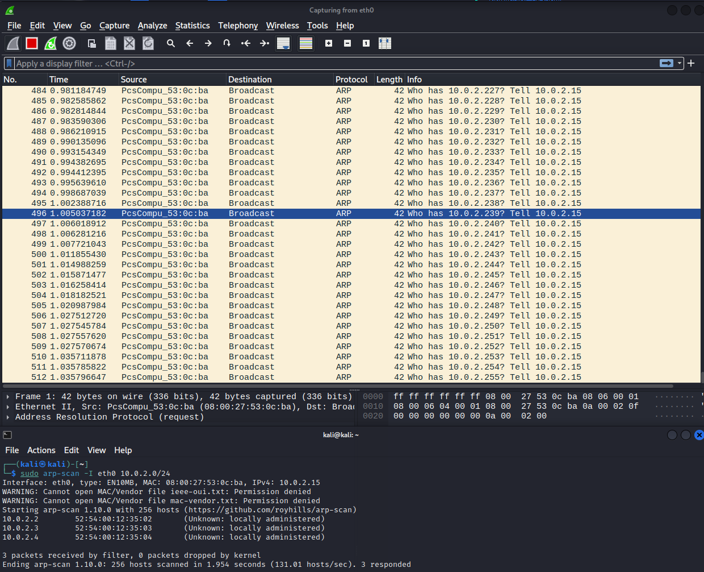
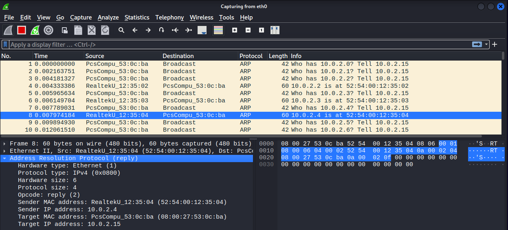
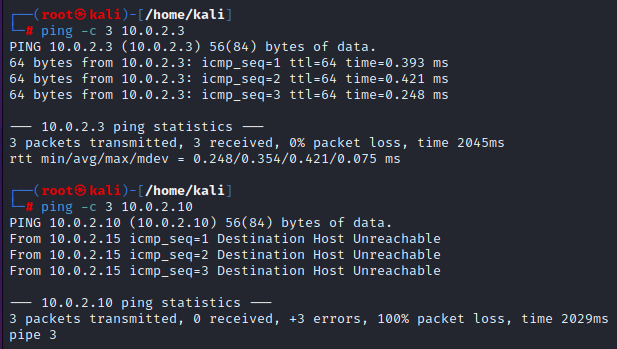

# 1.2 Footprinting & Scanning

**Domain:** Assessment methodologies | **Status:** draft | **Authorized targets only**

---

## 1. How it works (from zero)

**Mapping a network** means finding every device, how they're connected, and what's reachable, before touching anything further.

### Addressing, two layers
- **IP address** (layer 3, routable): identifies a device across networks. IPv4 is 32-bit (`192.168.1.1`); IPv6 is 128-bit, built because IPv4 addresses ran out.
- **MAC address** (layer 2, local only): a 48-bit hardware identifier burned into a network card by its manufacturer, written as `00:1A:2B:3C:4D:5E`. The first half (OUI) identifies the vendor. MAC addresses never leave the local network segment; routers strip them at each hop.

**ARP (Address Resolution Protocol)** bridges the two layers on a local network: when a device knows a target's IP but not its MAC, it broadcasts "who has this IP?" and the owner replies with its MAC. Every device keeps this mapping in an **ARP cache** (view it with `arp -a` on Windows or `ip neigh` on Linux).

Find your own IP and interface on Linux:
```bash
ip -br -c a
```

### Where this fits in an attack chain
1. **Physical/OSINT recon** — site access, public records, social engineering (covered in 1.1).
2. **Sniffing** — passively watch traffic on a network you're already connected to, to learn IPs, MACs, and active hosts without sending anything yourself.
3. **Active discovery** — ARP scans and ping sweeps to confirm what's actually alive.
4. **Port scanning** — find open doors on the hosts you found.

### ICMP and ping
**Ping** sends an ICMP Echo Request and times the Echo Reply; the round-trip time is latency. Useful for confirming a host is up and diagnosing basic connectivity, but many hosts/firewalls block ICMP, so "no reply" never proves a host is down.

### TCP port states, precisely
| Exchange | Port state |
|---|---|
| SYN → SYN/ACK → ACK (full handshake), then RST+ACK to close | **open** |
| SYN → RST/ACK | **closed** |
| SYN → SYN/ACK → **RST** (never finishes the handshake) | **"stealthy" / half-open scan (SYN scan)** |
| SYN → SYN/ACK → ACK → banner received → RST/ACK | **service version scan** (noisier: a real connection is made and data exchanged) |

---

## 2. The attacker's view

- **ARP scanning** (same subnet only) is the fastest, most reliable way to find live hosts — no ICMP blocking can hide a device that must answer ARP to function on the LAN.
- **MAC vendor prefixes** can hint at device type (e.g. known printer or IoT vendor ranges), useful for picking easy targets.
- **Sniffing ARP traffic** passively (no packets sent) can map a network just by listening, which is harder to detect than active scanning.
- A **SYN scan** is preferred for scanning because it never completes the handshake, so some older logging misses it; it is **not actually stealthy against a modern IDS/firewall**, which is why "stealthy" is in quotes.
- **Service version scans are noisy** on purpose: they complete real connections and often trigger application-level logs, not just the OS/firewall.

---

## 3. Methodology

```bash
# --- Local network mapping ---
ip -br -c a                       # your own IP/interface
arp -a                            # view ARP cache (or: ip neigh)

sudo arp-scan --interface=eth0 --localnet     # active ARP sweep of the LAN
sudo netdiscover -r 192.168.1.0/24            # similar, continuous/passive mode available

# Confirm specific hosts with ping
ping -c 3 192.168.1.5

# fping: the same idea, but for many hosts at once (faster, scriptable)
fping -I eth0 -g 192.168.1.0/24 -a 2>/dev/null
# -a = show only alive hosts; stderr suppressed to drop "Host Unreachable" noise

# --- Nmap host discovery (works locally via ARP, remotely via ICMP/TCP probes) ---
nmap -sn 192.168.1.0/24           # ping scan, no ports
nmap -n -Pn <target>              # skip DNS resolution (-n) and skip host-up check (-Pn)

# --- Port scanning (see 1.3 for what to do with each open port) ---
nmap -p- --min-rate 1000 -T4 <target>          # all 65535 ports, fast
nmap -sC -sV -O -p <ports> <target>            # scripts + version + OS on the ports found
```

Watch the sniffed traffic live while scanning with **Wireshark**: start a capture on the same interface, then run `arp-scan` or `nmap` in another terminal and watch the ARP requests/replies or TCP handshakes appear in real time. This is the fastest way to *see* what a scan actually does on the wire, rather than just trusting the tool's summary.

A GUI alternative to the Nmap command line is **Zenmap**: same engine, with saved profiles, a results table, and topology/diff views — useful for comparing two scans of the same network over time.

### 📸 Screenshots / proof of work

**Confirming my own interface and subnet first** (`ip -br -c a`), before scanning anything:


_eth0 is my attacking interface at 10.0.2.15/24, so the live-host sweep below targets 10.0.2.0/24._

**Watching an ARP sweep live in Wireshark** while running `sudo arp-scan -I eth0 10.0.2.0/24` in parallel:


_This is arp-scan systematically asking "who has" for every address in the /24 — exactly the broadcast-then-wait pattern described above, visible frame by frame. The terminal output (bottom of the same screenshot) confirms only 3 of the 256 possible hosts actually answered._

**Inspecting one ARP exchange in detail** (a full request/reply pair, not just the sweep):


_Frame 8 is the reply: opcode `reply (2)`, the sender's real MAC (RealtekU_12:35:04) mapped to its IP (10.0.2.4), addressed back to my attacking MAC. This is the raw version of what `arp -a` or an ARP-scan summary abstracts away — useful to understand once, even if you don't read it packet-by-packet every time._

**Ping against a live vs. a non-existent/blocked host**, to confirm the "no reply ≠ down" point made above:


_10.0.2.3 answers normally. 10.0.2.10 returns "Destination Host Unreachable" **from my own gateway (10.0.2.15)**, not from the target — meaning my own network/routing has no path to that address at all, which is a different situation from a host silently dropping ICMP. Worth distinguishing: one means "no route exists", the other means "something chose not to answer."_

---

## 4. Nmap scan techniques and NSE
The source PDF covers several Nmap scan types and the Nmap Scripting Engine (NSE). These commands are for controlled labs or explicitly authorized targets.

### TCP scan types
| Scan | Flag | Source-note interpretation |
|---|---|---|
| TCP connect | -sT | Completes the TCP handshake; generally more visible |
| SYN / half-open | -sS | Sends SYN and does not complete the handshake |
| UDP | -sU | Scans UDP services; slower and results may be less conclusive |
| Null | -sN | Sends a TCP packet with no flags set |
| FIN | -sF | Sends a TCP FIN packet |
| Xmas | -sX | Sets FIN, PSH, and URG flags |
| ACK | -sA | Helps map firewall filtering behavior; RST indicates unfiltered, no response may indicate filtered |
| Idle | -sI | Uses a third-party “zombie” host and IP-ID behavior to infer target port state |

For Null/FIN/Xmas scans, the source notes describe no response as open/filtered, RST as closed, and certain ICMP unreachable responses as filtered. These scans depend on target OS and firewall behavior; do not treat silence as proof that a port is open.

### Nmap options and scan scope
~~~bash
nmap -sn <authorized-subnet>       # host discovery only
nmap -p- <authorized-host>         # all TCP ports
nmap -p22,80,443 <authorized-host> # selected ports
nmap -sV <authorized-host>         # service/version detection
nmap -O <authorized-host>          # OS detection
nmap -A <authorized-host>          # aggressive detection and scripts; noisy
nmap -sS -sU <authorized-host>     # TCP SYN and UDP scans
~~~

The source also discusses decoy and fragmentation options:
~~~bash
nmap -D RND:5 <authorized-host>
nmap -f <authorized-host>
~~~

A decoy scan adds apparent source addresses to scan traffic; it does not make the real scanner anonymous. Fragmentation splits probe packets and may interact differently with network devices. Neither technique should be treated as a guaranteed firewall/IDS bypass.

### Nmap Scripting Engine (NSE)
NSE scripts automate enumeration and selected checks. The source lists these categories:

| Category | General purpose / caution |
|---|---|
| default, safe | Basic or low-risk information gathering |
| discovery, enum | Discover hosts and enumerate services |
| vuln | Check for known vulnerability conditions; false positives are possible |
| auth | Authentication-related checks |
| brute | Brute-force activity; potentially disruptive |
| exploit | Exploitation behavior; high risk |
| intrusive, dos | Potentially disruptive or denial-of-service behavior |
| malware | Checks related to malware/backdoors |
| broadcast | Network-wide discovery behavior |

Examples from the source:
~~~bash
nmap -sC <authorized-host>
nmap --script http-title <authorized-host>
nmap --script http-title,http-headers <authorized-host>
nmap -p80 --script http-enum <authorized-host>
nmap --script vuln <authorized-host>
~~~

NSE output is evidence to investigate, not automatic proof. Review script documentation and expected side effects before execution. Start with appropriate safe/default enumeration and avoid brute-force, exploit, intrusive, and DoS categories unless explicitly approved.

## 5. Real CVEs & further reading

- **ARP spoofing/poisoning** (not a CVE, a protocol-level weakness): ARP has no authentication, so any device on the LAN can claim to own any IP. This underlies man-in-the-middle attacks on local networks.
- Scanning itself doesn't map to a CVE — it's how vulnerabilities (see 1.4) get *found* once a service and version are known.

---

## 6. Self-test

1. Why does ARP scanning find hosts that a ping sweep might miss?
2. What's actually different between a SYN scan and a full connect scan, from the target's point of view?
3. Why might a service version scan ("noisy") get logged when a SYN scan doesn't?
4. Why does `-Pn` not disable DNS resolution, and why would you want both `-n` and `-Pn` together?

---

## 7. Quick recap

- MAC = local-only hardware ID, IP = routable logical ID; ARP bridges them on a LAN.
- ARP-based discovery beats ICMP-based discovery on a local subnet because ARP can't be silently dropped without breaking the device's own networking.
- SYN scans are quieter, not invisible; version scans are accurate but noisy.
- Wireshark + a scanner together show you what a scan actually looks like on the wire.
