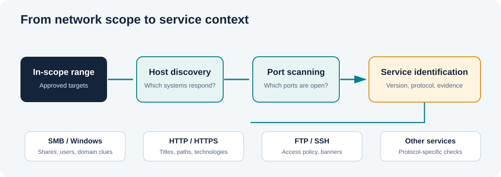

# Host & Network Penetration Testing

| Chapter | Topics |
|---|---|
| [2.1 System / Host-Based Attacks](2.1-system-host-based-attacks/) | Linux foundations, Active Directory, Linux and Windows vulnerabilities |
| [2.2 Network-Based Attacks](2.2-network-based-attacks.md) | TCP/IP, addressing, subnetting, switching, VLANs, routing, NAT, ARP, DHCP, sniffing, wireless, TLS |
| [2.3 Metasploit Framework](2.3-the-metasploit-framework/) | Framework concepts, modules, scanning, exploitation, client-side attacks, Meterpreter, Armitage |
| [2.4 Exploitation](2.4-exploitation.md) | Vulnerability validation, exploit research, shells, and exploitation workflows |
| [2.5 Post-Exploitation](2.5-post-exploitation.md) | Host enumeration, sessions, privilege context, file transfer, pivoting, and reporting |
| [2.6 Social Engineering](2.6-social-engineering.md) | Phishing concepts and authorized awareness simulations |
